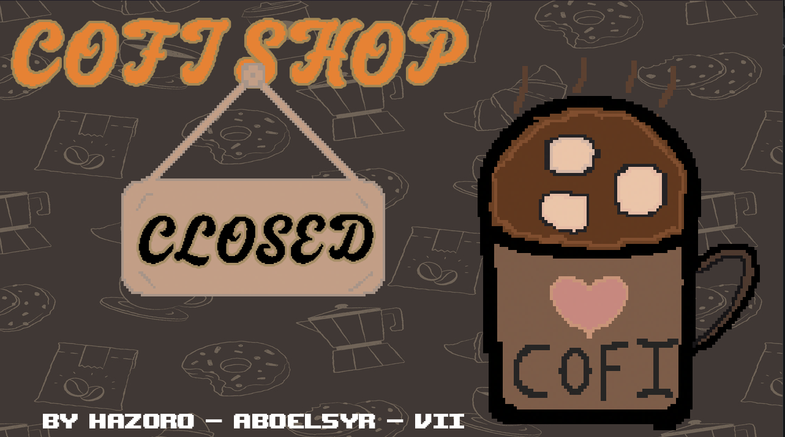
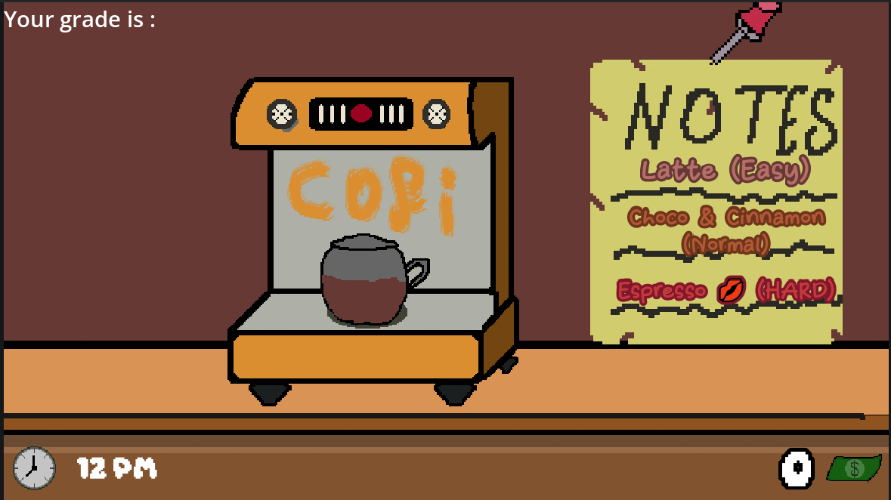
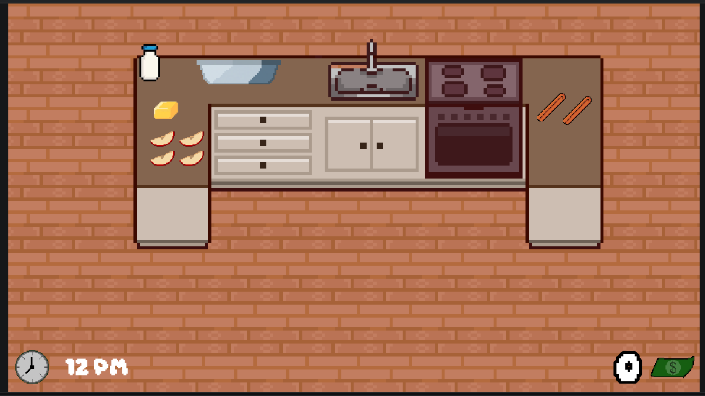
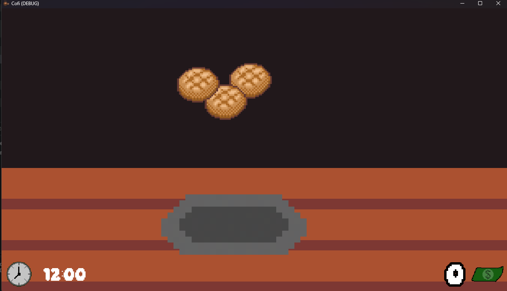
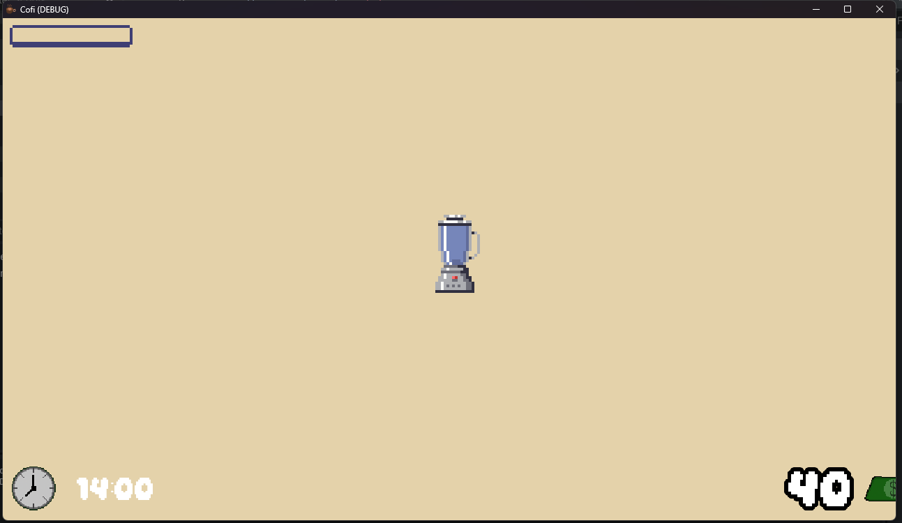
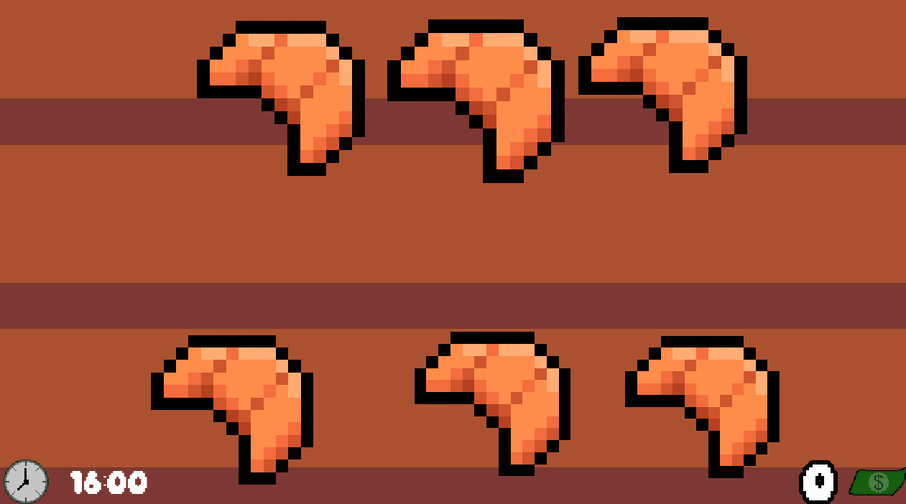
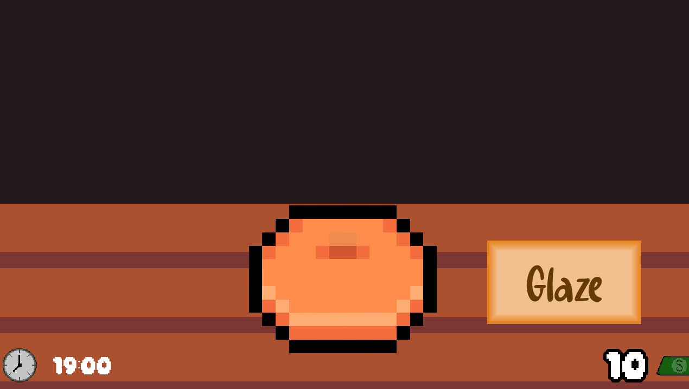

# Cofi, your cozy cofi shop :D
## By [Hazoro](https://github.com/hazorox) - [Vii](https://github.com/vii-abdullatif) - [AboEl5yr](https://github.com/AdhamMohamedKhairy)



# Idea
You are a coffee shop barista, you go to the kitchen counter, pick whatever your recipe you would like to make !!

With more recipes done, you get more money profit !!

# Recipes
## Coffee, Duh :P
Get the bean in the correct area and brew to perfection !

Use interact to click

Comes with different flavors : Latte, Hot Chocolate & Cinnamon, and Espresso 💋


## Apple Pie
Slice apples, and make your own pies!!
(Slicing may lag a bit but just spam till it works :P)


## Cheese cake
Yummy !
Just use common sense

just roll the doughhh


## Cinnamon Drink
Catch me if you can1!!
gather the stuff inside the blender in time
and then catch the blender fast with mouse


## Cwaso (Croissants)
Just follow the guidelines and steps :P



## Donut
Yumm



# Controls
- Movement : WASD, Arrows
- Interaction : E, Space
- Pause : Escape
- Common Interaction : Mouse LMB

# Building from source
```sh
git clone https://github.com/hazorox/cofi
cd cofi/ # Then open the folder with Godot 4.7
```

# AI Usage, Hazoro (Claude)
- Debugging errors
- Help with time logic
- logic of spinning bean
- help plan how to manage scenes overriding

Made With <3 for Hackclub!!